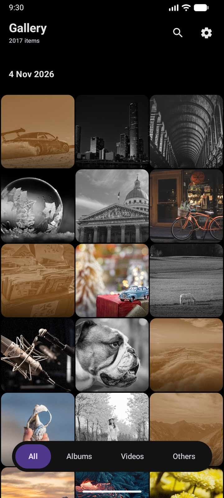
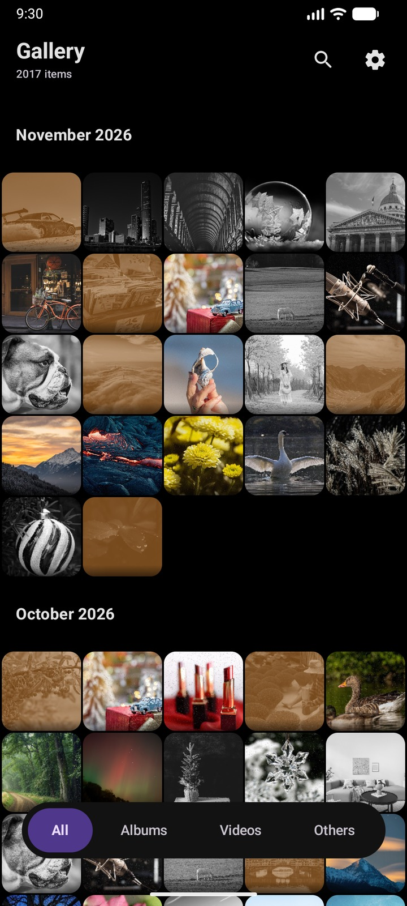
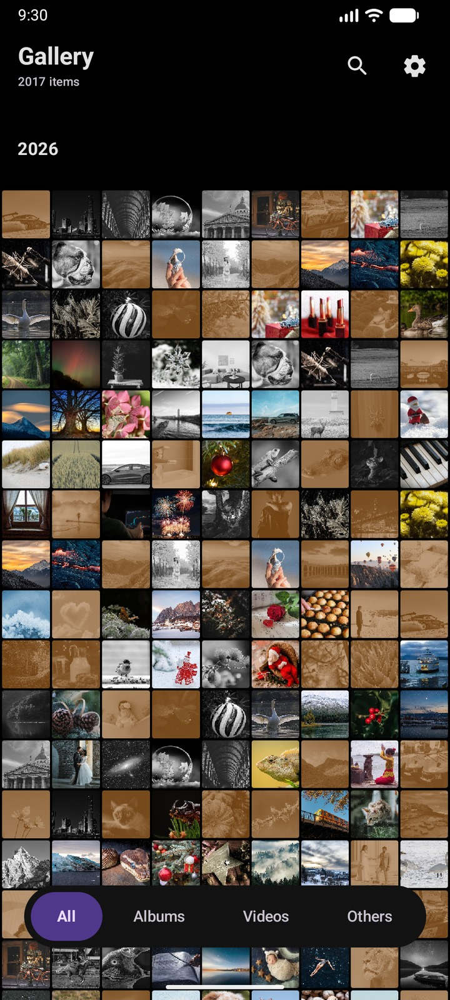
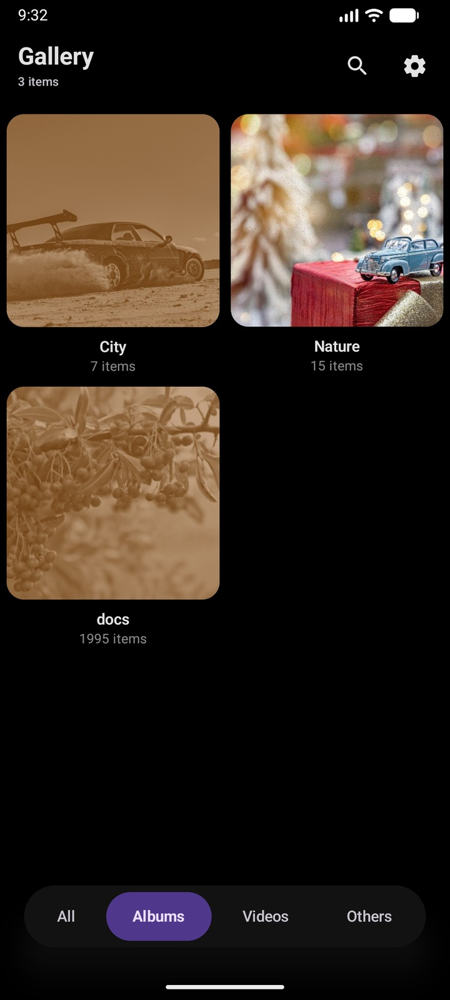
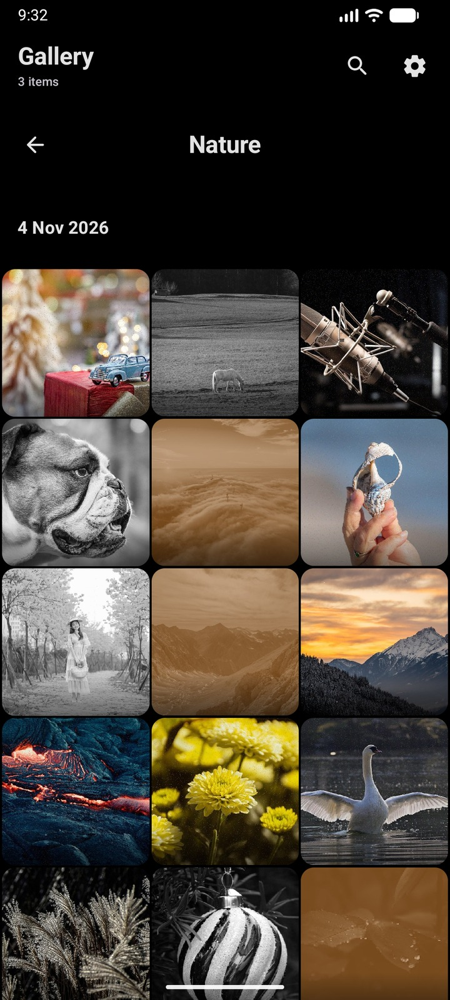
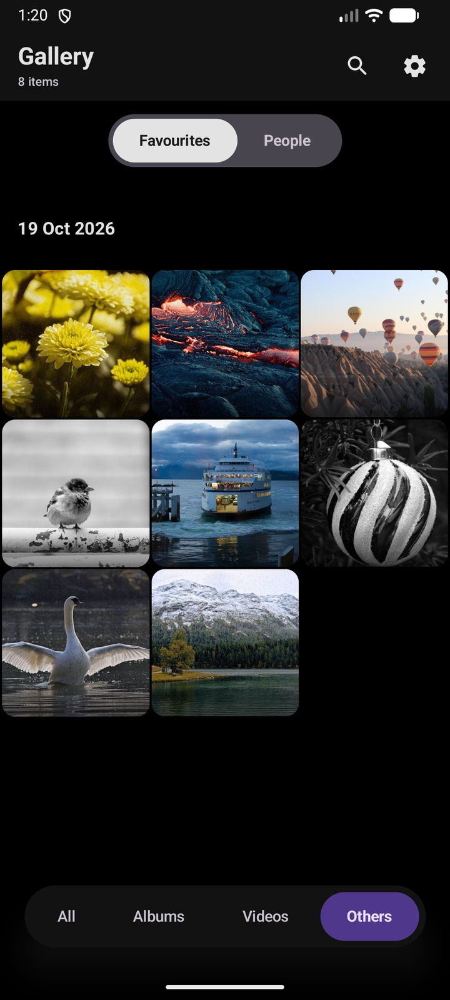
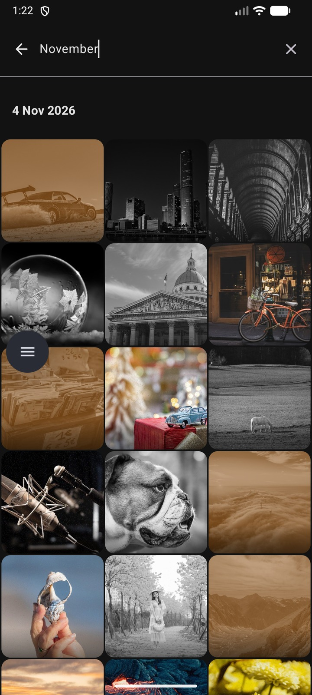
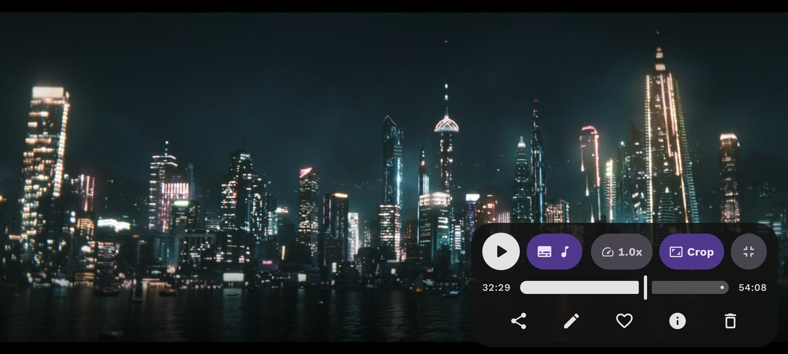

<div align="center">

# Chronicle

**A private, fast photo and video gallery for Android, built entirely in Jetpack Compose.**

[](https://kotlinlang.org)
[](https://developer.android.com/jetpack/compose)
[](https://dagger.dev/hilt/)
[](https://developer.android.com/training/data-storage/room)
[](https://www.tensorflow.org/lite)
[](https://developers.google.com/ml-kit)

Browse, play, organise, search, and find people in your library. Everything runs on the device. No accounts, no uploads, no network calls.

</div>

---

## Overview

Chronicle is a full local gallery: your photos and videos, grouped the way you actually think about them, wrapped in an interface that moves well and gets out of the way.

It is built on a strict MVI architecture with a single source of truth per screen, and the ML work is treated as a first class citizen rather than a bolt-on. Face indexing has real progress, real pause and resume, and survives app kills and reboots.

**Package** `com.myurrrjj.chronicle` · **Min SDK** 26 · **Target SDK** 37 · **Language** Kotlin · **UI** 100% Compose

---

## Screenshots

### Homescreen

Pinch the grid to move between Day, Month and Year grouping.

| Day | Month | Year |
|:---:|:---:|:---:|
|  |  |  |

### Albums

| Album grid | Album opened |
|:---:|:---:|
|  |  |

### Favourites



### Search



### Video player



---

## Features

### Browse the whole library

Four tabs: **All**, **Albums**, **Videos**, and **Others** (Favourites or People). Albums are built from your real folder structure, not a heuristic.

Three grouping modes drive the timeline: **Day**, **Month** and **Year**. Each one changes both the header format and the cell size, so the grid gets denser as you zoom out.

**Pinch the grid** to move between them. The gesture is a custom `galleryZoomGesture` with a 1.3x / 0.7x threshold and a haptic tick on every transition, so the change feels deliberate rather than accidental.

### Find people

On device face indexing, described in full below. Face detection with ML Kit, 128 dimension embeddings from a TFLite model, and greedy cosine clustering into person groups you can rename.

### Look at a photo

Tap any thumbnail and it flows into the full viewer on a **shared element transition**, keyed per media item. Inside the viewer you get pinch and double tap zoom, and the full metadata sheet.

### Play a video

A custom control surface over ExoPlayer with:

- Playback speed control
- Three resize modes: fit, crop, stretch
- Subtitle track selection with an overlay renderer
- Landscape handoff and auto hiding controls

### Organise

Long press to enter selection mode, then act on the whole selection at once:

- **Favourite** or unfavourite
- **Share** one or many through the system chooser
- **Copy** the content URI to the clipboard
- **Edit** by handing off to any installed editor
- **Delete** through MediaStore
- **Info** for the full metadata sheet

The contextual bar and floating action bar appear and retreat based on selection and scroll state, so the grid stays clean when you are just looking.

### Search

An FTS4 index built over the library, refreshed incrementally as media changes. It indexes:

- File name
- Folder name
- Type words (`photo`, `image`, `video`, `mp4`)
- Favourite status
- The full date string

Queries are prefix matched per word, so `aug beach` finds beach photos from August.

### Make it yours

- Auto play videos on or off
- Default grouping mode on launch
- Face indexing schedule: manual, on app open, charging only, or overnight
- Automatic pause on low battery and on low storage
- Light and dark themes following the system, edge to edge, Material 3

### Design details

The interface is animated on purpose, not decoratively:

- Shared element transitions between grid, album and person views
- `bouncyClick`, a spring scale press effect used on every card and control
- `AnimatedContent` tab transitions with directional slide and fade
- Animated segmented controls that morph their background colour
- Floating bars that appear on scroll up and hide on scroll down
- Staggered, animated rows inside the info sheet

---

## How face indexing works

This is the part worth reading before you touch the code.

```
MediaStore
   |
   v
BitmapLoader           decode at 1024px, EXIF corrected, RGB_565
   |
   v
MlKitFaceDetector      ACCURATE mode, all landmarks, minFaceSize 0.03
   |                   rejects: <40px, bad aspect ratio, >60 degree head angles
   v
FaceCropper            5 point similarity transform to the ArcFace 112x112 template
   |
   v
FaceEmbedder           sface TFLite, CPU only, 128 dimension vector
   |
   v
Room transaction       embeddings + per photo ledger, atomically
   |
   v
FaceClusterer          greedy cosine similarity, threshold 0.36
   |
   v
People tab             covers, counts, rename
```

**Pause and resume** are cooperative, not cancellable. A persisted flag in DataStore is read only at batch boundaries, so a batch of 20 photos always commits whole or not at all. Resume continues from the first photo not in the ledger. Force stop exists as an escape hatch and is safe because the batch commit is a single Room transaction and orphaned embeddings are re-clustered at the start of the next run.

**Progress** is a merge of four sources: WorkManager state, the persisted pause flag, live per photo counters held in memory, and durable counts from Room. `FaceIndexingController` is the single owner of every action, shared by both the gallery and settings screens.

---

## Tech stack

| Area | Choice |
|---|---|
| Language | Kotlin 2.3 |
| UI | Jetpack Compose, Material 3, Compose BOM 2026.03.01 |
| Architecture | MVI, unidirectional data flow |
| DI | Dagger Hilt 2.57.2 |
| Local storage | Room 2.8.5, DataStore Preferences |
| Image loading | Coil 2.7 with a custom MediaStore thumbnail fetcher |
| Video | Media3 ExoPlayer 1.3 |
| ML | ML Kit face detection 16.1.7, TensorFlow Lite 2.16.1 |
| Background work | WorkManager 2.9.1 with Hilt integration |
| Navigation | Navigation Compose 2.8.3, type safe routes |
| Serialization | kotlinx.serialization 1.7.3 |
| Build | AGP 8.13, Gradle 8.13, JDK 17, KSP |

---

## Architecture

### Layers

```
presentation/   Compose screens, MVI contracts, ViewModels
domain/         Models, repository interfaces, use cases
data/           MediaStore, Room, DataStore implementations
core/           MVI base classes, ML pipeline, utilities
worker/         WorkManager jobs
di/             Hilt modules
```

Dependencies point inward. The domain layer knows nothing about Android, Room, or Compose.

### MVI

Every screen has a contract of three types: `State`, `Event`, `Effect`. `BaseViewModel` exposes a `StateFlow<State>`, consumes events from a `SharedFlow`, and emits one shot effects over a `Channel`.

```
UI dispatches Event  ->  ViewModel reduces State  ->  UI recomposes
                     ->  Effect (navigation, share, delete)
```

### Database

`GalleryDatabase`, version 5, with six entities:

| Table | Purpose |
|---|---|
| `favourite_media` | Favourited media ids |
| `face_embeddings` | One row per detected face: 128 float vector, bounding box, source media |
| `face_clusters` | One row per person: label, cover embedding, timestamps |
| `media_person` | Join table, cascade deletes from both parents |
| `media_processing_status` | The indexing ledger, one row per processed photo |
| `search_index` | FTS4 table for search |

---

## Project structure

```
app/src/main/java/com/myurrrjj/chronicle/
├── core/
│   ├── indexing/        FaceIndexingController, FaceIndexingProgressTracker
│   ├── ml/              MlKitFaceDetector, FaceCropper, FaceEmbedder,
│   │                    FaceQualityAssessor, FaceClusterer
│   ├── presentation/    BaseViewModel, MVI contracts, modifiers, indexing UI
│   └── util/            BitmapLoader, MediaIntents, NativeThumbnailFetcher
├── data/
│   ├── local/           GalleryDatabase, DAOs, entities, converters
│   └── repository/      MediaStore, Face, Search, Settings implementations
├── di/                  Hilt modules
├── domain/
│   ├── model/           MediaAsset, PersonCluster, AppSettings, FaceIndexingProgress
│   ├── repository/      Interfaces
│   └── usecase/         GroupMediaUseCase, GetFilteredMediaUseCase
├── presentation/
│   ├── gallery/         GalleryViewModel, screens, components
│   ├── navigation/      Type safe routes, NavGraph
│   ├── search/          Search screen and ViewModel
│   ├── settings/        Settings screen and ViewModel
│   └── editor/          Editing state models
├── trial/               Face Quality Lab, a developer tool
├── ui/theme/            Colours, typography, theme
└── worker/              FaceIndexingWorker
```

---

## Getting started

### Requirements

- Android Studio with AGP 8.13 support
- JDK 17
- Android SDK 37
- A physical device for anything involving the camera roll or ML

### Build

```bash
git clone https://github.com/myurrrjj/Chronicle-Gallery-App.git
cd Chronicle-Gallery-App
./gradlew :app:assembleDebug
```

### The face model

The embedding model is **not** in this repository. It is gitignored and must be added before face indexing will do anything:

```
app/src/main/assets/sface_embedder_fp32.tflite
```

`FaceEmbedder` expects input `[1, 112, 112, 3]` and output `[1, 128]`, and validates both shapes at load time. If the file is missing, the app still runs, but indexing completes with zero faces and no error, so check this first if the People tab stays empty.

---

## Permissions

| Permission | Why |
|---|---|
| `READ_MEDIA_IMAGES` | Browsing the full photo library, building albums, indexing |
| `READ_MEDIA_VIDEO` | The Videos tab and the video timeline |
| `READ_MEDIA_VISUAL_USER_SELECTED` | Partial access on Android 14 and above |
| `READ_EXTERNAL_STORAGE` | Same, on API 32 and below only |
| `POST_NOTIFICATIONS` | Indexing progress notification |
| `FOREGROUND_SERVICE`, `FOREGROUND_SERVICE_DATA_SYNC` | Keeping indexing alive while you leave the app |

A system picker cannot replace these. Chronicle needs to enumerate the whole library, read folder structure for Albums, and keep persistent access so indexing can run across sessions.

---

## Privacy

There is no network code in this app. No analytics, no crash reporting service, no accounts.

- Photos and videos never leave the device
- Face embeddings are computed locally and stored in a local Room database
- Face crops are written to app private storage under `filesDir/face_crops`
- Uninstalling the app, or tapping Reset in the People tab, deletes all of it

---

## Release builds

Release builds run R8 with resource shrinking. Rules live in `app/proguard-rules.pro` and cover the five things that actually break under obfuscation here: kotlinx.serialization route lookups, the WorkManager worker class name, enum names persisted to DataStore, TensorFlow Lite JNI, and the `PlayerView` constructor used by layout inflation.

`app/build/outputs/mapping/release/mapping.txt` is the only way to read a production stack trace. Archive it with every release.

---

## Roadmap

- [ ] In app photo editor. `PhotoEditState` and `CropRect` exist as models, nothing renders them yet
- [ ] Face indexing for videos, currently images only
- [ ] Merge or split person clusters after the fact
- [ ] Album covers and pinning
- [ ] Re-index a single photo without a full reset

---

## Contributing

Issues and pull requests are welcome. If you are changing the ML pipeline, run the Face Quality Lab first: it takes a labelled photo set, shows every detection decision and quality metric, and sweeps cosine thresholds so you can pick one from data rather than by guessing.

---

## License

No license file is included in this repository yet. Add one before distributing or accepting contributions.
